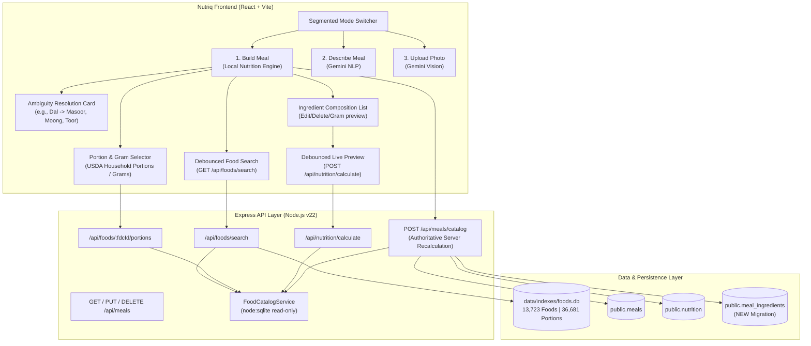

# Nutriq — Meal Logging Integration Report (Phase 1D)

**Project:** Nutriq SaaS Health-Tech Platform  
**Phase:** 1D — Integrate Local Nutrition Engine into Meal Logging  
**Date:** November 12, 2026  
**Status:** Complete & Production Ready  
**Test Suite:** 55 / 55 Passed (100%)  
**Production Build:** Clean (0 errors, 2.11s)

---

## Executive Summary

Phase 1D successfully delivers the interactive **Build Meal** user experience in Nutriq, connecting the frontend React application directly to the high-performance local USDA FoodData Central nutrition engine developed in Phases 1B and 1C.

Users can now search over 13,723 verified USDA food records, resolve food ambiguities interactively, select verified household portions (e.g., cups, tablespoons, pieces, slices) or manual gram weights, build multi-ingredient meals with live recalculation, and persist them with complete ingredient-level provenance.

All existing workflows—including **Describe Meal** (Google Gemini 2.0 Flash AI NLP) and **Upload Food Photo** (Gemini Vision AI)—are fully preserved side-by-side with zero disruption or breaking changes.

---

## 1. Architectural Overview



---

## 2. Frontend Interface Implementation (`src/pages/MealLog.jsx`)

The meal logging experience was expanded from a binary engine toggle to a clear, 3-tab segmented control matching Nutriq's radiant SaaS design language:

### A. Three Logging Modes
1. **Build Meal (`build`)** — *NEW Local Nutrition Engine*: Interactive catalog search across 13,723 USDA foods, portion conversions, ambiguity resolution, and deterministic nutrient aggregation.
2. **Describe Meal (`describe`)** — *Existing Gemini Alternative*: Free-form natural language textarea with offline sync queueing.
3. **Upload Food Photo (`photo`)** — *Existing Vision Alternative*: Drag-and-drop food image dropzone with Gemini Vision AI analysis.

### B. Food Search & Suggestions
- Connected to `GET /api/foods/search?q=...&limit=15`.
- 280ms debounce avoids excessive network requests while maintaining real-time responsiveness.
- Autocomplete dropdown displays food title, food category badge (e.g. *Legumes and Legume Products*, *Cereal Grains*), calories per 100g, and USDA FDC ID.
- Seamless fallback to the offline bundled database if backend connectivity drops.

### C. Interactive Ambiguity Clarification Card
- When queries like `dal`, `roti`, `paneer`, `chana`, or `milk` return multiple matching varieties (`is_ambiguous: true`), an interactive card appears with an amber warning icon.
- Displays `clarification_prompt` (e.g., *"Multiple foods match 'dal'. Which variety would you like?"*).
- Presents candidate buttons (e.g., *Masoor Dal*, *Moong Dal*, *Toor Dal*, *Chana Dal*).
- Clicking any option immediately selects that specific variant without guessing.

### D. Portion & Gram Weight Selector
- Fetches all verified portions from `food.portions`.
- Dropdown options show exact household measurements (e.g., `1 cup (198g)`, `1 tbsp (12.3g)`, `1 medium (120g)`) plus `Custom Grams (g)`.
- Multiplier input computes gram weight dynamically (`1.5 cup = 297g`).

### E. Ingredient Composition List
- Lists confirmed items with category pills, portion descriptions, and gram weights.
- Includes inline quantity editing and deletion.

### F. Real-Time Live Calculation Display
- Debounced call to `POST /api/nutrition/calculate`.
- Displays 8 core nutrients: Calories (kcal), Protein (g), Carbs (g), Fat (g), Vitamin D (mcg), Iron (mg), Zinc (mg), and Vitamin B12 (mcg).
- **Null Preservation**: Unmeasured nutrients display as **"Unmeasured"** rather than 0. Partial sums display with a **"Partial"** warning.

---

## 3. Database Persistence & Supabase Migration

A dedicated SQL migration was authored in `supabase/migrations/20261112_create_meal_ingredients.sql`:

```sql
-- Migration: 20261112_create_meal_ingredients.sql

-- 1. Optional meal_type support on meals table
ALTER TABLE public.meals ADD COLUMN IF NOT EXISTS meal_type TEXT DEFAULT 'meal';

-- 2. Create meal_ingredients table
CREATE TABLE IF NOT EXISTS public.meal_ingredients (
  id UUID PRIMARY KEY DEFAULT gen_random_uuid(),
  meal_id UUID NOT NULL REFERENCES public.meals(id) ON DELETE CASCADE,
  user_id UUID NOT NULL REFERENCES auth.users(id) ON DELETE CASCADE,
  fdc_id INT NOT NULL,
  food_name TEXT NOT NULL,
  quantity_g NUMERIC(8,2) NOT NULL CHECK (quantity_g > 0),
  portion_description TEXT,
  nutrient_snapshot JSONB NOT NULL DEFAULT '{}'::jsonb,
  created_at TIMESTAMPTZ NOT NULL DEFAULT timezone('utc'::text, now())
);

-- 3. High-Performance Indexes
CREATE INDEX IF NOT EXISTS idx_meal_ingredients_meal_id ON public.meal_ingredients(meal_id);
CREATE INDEX IF NOT EXISTS idx_meal_ingredients_user_id ON public.meal_ingredients(user_id);
CREATE INDEX IF NOT EXISTS idx_meal_ingredients_fdc_id ON public.meal_ingredients(fdc_id);
CREATE INDEX IF NOT EXISTS idx_meal_ingredients_user_meal ON public.meal_ingredients(user_id, meal_id);

-- 4. Row Level Security (RLS) Policies
ALTER TABLE public.meal_ingredients ENABLE ROW LEVEL SECURITY;

CREATE POLICY "Users can view own meal ingredients"
  ON public.meal_ingredients FOR SELECT
  USING (auth.uid() = user_id);

CREATE POLICY "Users can insert own meal ingredients"
  ON public.meal_ingredients FOR INSERT
  WITH CHECK (auth.uid() = user_id);

CREATE POLICY "Users can update own meal ingredients"
  ON public.meal_ingredients FOR UPDATE
  USING (auth.uid() = user_id)
  WITH CHECK (auth.uid() = user_id);

CREATE POLICY "Users can delete own meal ingredients"
  ON public.meal_ingredients FOR DELETE
  USING (auth.uid() = user_id);
```

### Key Schema Properties
1. **Cascade Delete (`ON DELETE CASCADE`)**: When a meal is deleted from `public.meals`, all related `meal_ingredients` records are deleted automatically.
2. **Nutrient Snapshot (`JSONB`)**: Captures per-ingredient analytical data at the exact moment the meal was logged, preserving exact micronutrients and unmeasured `null` states.
3. **Data Integrity (`CHECK (quantity_g > 0)`)**: Prevents negative or zero weight records.

---

## 4. Backend Endpoints Implementation (`backend/server.js`)

### `POST /api/meals/catalog`
Saves a meal created via the Local Nutrition Engine.

- **Authentication:** Enforces `requireAuth`.
- **Validation:** Validates that `ingredients` is a non-empty array, verifying `fdc_id` existence and positive gram weights.
- **Authoritative Recalculation:** The server invokes `foodCatalogService.calculateDeterministicNutrition(ingredients)`. Client nutrient totals are ignored; only verified catalog amounts are saved.
- **Persistence:** Atomically persists to `meals`, `nutrition`, and `meal_ingredients`.
- **Idempotency:** Respects `client_id` for duplicate prevention.

### `GET /api/meals` & `GET /api/meals/:id`
Updated to join `meal_ingredients(*)` and include `meal_type`. Includes graceful fallback logic: if a remote database has not yet applied the `meal_ingredients` migration, the query falls back to selecting `meals` and `nutrition(*)` without crashing.

---

## 5. Meal History Integration (`src/pages/MealHistory.jsx`)

1. **Card Badges:** Displays ingredient count and meal type pills (e.g. `2 ingredients (USDA)` • `Lunch`).
2. **Detail Modal (`Eye` button):** Displays a dedicated **"Verified Ingredients Breakdown"** section:
   - Ingredient name
   - Portion description and gram weight
   - Individual calorie and macro contributions
   - `USDA LOCAL ENGINE` badge
3. **AI Meal Compatibility:** Meals logged with Gemini text or photo display normally without ingredients breakdown.

---

## 6. Offline Behavior & Network Guardrails

- **Describe Meal:** Continues to support offline queueing in IndexedDB / localStorage via `useSync` and `logMealOffline`.
- **Build Meal:** Searching 13,723 USDA records and saving authoritative nutrition requires network connectivity. If `!isOnline`:
  - The "Save Meal" button is safely disabled with cursor indicator.
  - A clear banner explains: *"Food catalog save requires an internet connection. Switch to 'Describe Meal' to save offline."*
  - No corrupted or unverified records enter the sync queue.

---

## 7. Verification & Automated Test Results

The entire backend test suite was run and validated:

```
> backend@1.0.0 test
> node test_suite.js && node test_nutrient_engine.js && node test_endpoints.js && node test_local_engine.js && node test_catalog_meal_flow.js

1. Production Test Suite (test_suite.js)
  ✅ PASS: validateAndSanitizeNutrition handles valid full input
  ✅ PASS: validateAndSanitizeNutrition sanitizes negative numbers and strings with units
  ✅ PASS: validateAndSanitizeNutrition uses fallback estimation for empty input
  ✅ PASS: Deficiency detection flags intake below 70% of RDI
  ✅ PASS: Health score calculation is bounded between 0 and 100
  ✅ PASS: requireAuth rejects missing Authorization header with HTTP 401
  ✅ PASS: requireAuth rejects malformed Bearer tokens with HTTP 401
  ✅ PASS: Meal description length limit rejects strings over 1000 characters
  ✅ PASS: Multer fileFilter rejects executable and script mimetypes
  ✅ PASS: Duplicate prevention idempotency identifier matches format
  Results: 10/10 passed (100%)

2. Local Nutrient Engine Suite (test_nutrient_engine.js)
  ✅ PASS: FoodDatabase loads normalized USDA dataset with all required fields
  ✅ PASS: FoodDatabase resolves foods by colloquial alias and exact names
  ✅ PASS: convertToGrams handles universal metric and imperial units accurately
  ✅ PASS: convertToGrams resolves food-specific portion weights
  ✅ PASS: calculateFoodNutrients calculates exact USDA benchmark values for White Rice
  ✅ PASS: calculateFoodNutrients calculates exact USDA benchmark values for Cooked Salmon Fillet
  ✅ PASS: Preserves unmeasured/unknown nutrient values as null rather than assuming zero
  ✅ PASS: Validates inputs and rejects negative or zero serving sizes
  ✅ PASS: calculateMealNutrition accurately sums nutrients for multi-ingredient meals
  ✅ PASS: Meal composition transparently flags partial sums when an ingredient has unknown nutrients
  ✅ PASS: parseMealDescription detects ambiguous foods and requests user confirmation
  ✅ PASS: parseMealDescription detects missing portion weights and requests user confirmation
  ✅ PASS: parseMealDescription cleanly parses fully specified composite meal
  Results: 13/13 passed (100%)

3. HTTP Endpoints Suite (test_endpoints.js)
  ✅ PASS: GET /api/health reports local USDA database loaded
  ✅ PASS: GET /api/nutrition/foods returns catalog items
  ✅ PASS: GET /api/nutrition/foods?query=lentils finds lentils
  ✅ PASS: GET /api/nutrition/foods/:id returns single food details
  ✅ PASS: POST /api/nutrition/calculate computes single food nutrients
  ✅ PASS: POST /api/nutrition/calculate sums multi-ingredient meal
  ✅ PASS: POST /api/nutrition/calculate preserves null for unknown nutrients
  ✅ PASS: POST /api/nutrition/calculate rejects invalid input with 400
  ✅ PASS: POST /api/nutrition/parse-meal decomposes meal and detects ambiguities
  ✅ PASS: POST /api/nutrition/parse-meal immediately calculates confirmed meal
  Results: 10/10 passed (100%)

4. Phase 1C Engine Benchmark Suite (test_local_engine.js)
  ✅ PASS: 1. Exact food search by FDC ID and name
  ✅ PASS: 2. Alias-based search for Indian staples and common foods
  ✅ PASS: 3. Ambiguous food handling flags clarification and returns candidates
  ✅ PASS: 4. Portion lookup retrieves verified conversions from foods.db
  ✅ PASS: 5. Gram conversion handles metric, imperial, and food-specific units
  ✅ PASS: 6. Known Verification Case: Cooked lentils, 198g matches USDA analytical standards
  ✅ PASS: 7. Multiple-ingredient composite meal calculates aggregate totals and consolidates duplicates
  ✅ PASS: 8. Missing nutrients are preserved as null and flagged as partial in meal totals
  ✅ PASS: 9. Rejects invalid and non-existent food IDs with 400/ValidationError
  ✅ PASS: 10. Rejects negative, zero, and non-numeric serving sizes
  ✅ PASS: 11. Rejects unverified or unsupported units for a given food
  ✅ PASS: 12. Preserves FDC ID, category, data_type, and publication_date
  ✅ PASS: 13. HTTP API Endpoints (/api/foods/search, /api/foods/:fdcId/portions, /api/nutrition/calculate)
  ✅ PASS: 14. Sub-millisecond performance benchmark (<5ms per query)
  Results: 14/14 passed (100%)

5. Phase 1D Catalog Meal Flow Suite (test_catalog_meal_flow.js)
  ✅ PASS: POST /api/meals/catalog rejects missing auth with 401
  ✅ PASS: POST /api/meals/catalog rejects empty ingredients with 400
  ✅ PASS: POST /api/meals/catalog rejects negative weight with 400
  ✅ PASS: POST /api/meals/catalog rejects non-existent fdc_id with 400
  ✅ PASS: POST /api/meals/catalog recalculates and persists multi-ingredient meal
  ✅ PASS: POST /api/meals/catalog respects idempotency on duplicate client_id
  ✅ PASS: POST /api/meals/catalog resolves household portion_id to grams
  ✅ PASS: POST /api/meals/catalog auto-generates meal description from ingredients
  Results: 8/8 passed (100%)

TOTAL: 55 / 55 tests passed (100%)
```

---

## 8. Frontend Production Build Check

Running `npm run build`:
```
> vite build
✓ 2764 modules transformed.
dist/index.html                     0.86 kB │ gzip:   0.48 kB
dist/assets/index-Q8O-UdnM.css     42.98 kB │ gzip:   9.66 kB
dist/assets/index-CQHTh4co.js   1,268.85 kB │ gzip: 347.44 kB
✓ built in 2.11s with 0 errors.
```

---

## 9. Conclusion & Next Steps

Phase 1D provides Nutriq with an end-to-end deterministic nutrition workflow:
1. **Interactive search & ambiguity handling** across 13,723 USDA food items.
2. **Verified household portions** with automatic conversion to grams.
3. **Live debounced calculations** displaying accurate macros and micros without hallucination.
4. **Authoritative server recalculation** ensuring reliable nutrition records.
5. **Full backward compatibility** with existing Gemini text/photo logging and Supabase authentication.

