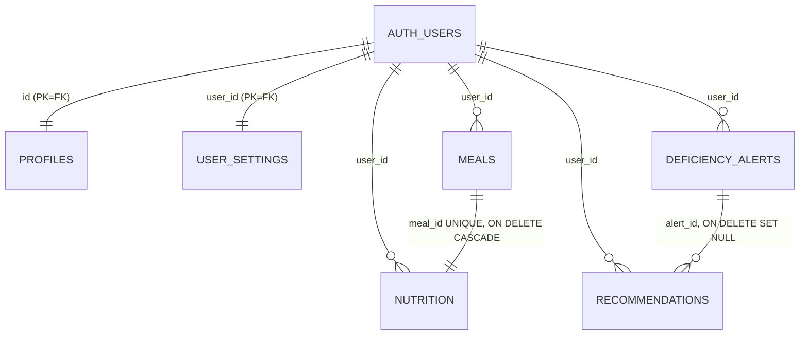

# Nutriq — Complete Technical & Functional Report

> **Scope:** This report describes what the code in this repository *actually does* as of the latest commit on `main` (`8363098`). It was written by inspecting the source, the SQL schema, the configuration files, and by running the backend test suite, ESLint, and a production build. Where older documentation (`README.md`, `PROJECT_REPORT.md`, `github/DEPLOY.md`) disagrees with the code, the code wins and the gap is called out in §23 and §24.
>
> **Status legend used throughout:** ✅ Implemented · ⚠️ Partial / implemented with defects · ❌ Not implemented (referenced only in docs, UI, or schema)

---

## Table of Contents

1. [Project Overview](#1-project-overview)
2. [Application Features](#2-application-features)
3. [Technology Stack](#3-technology-stack)
4. [High-Level Architecture](#4-high-level-architecture)
5. [Frontend Architecture](#5-frontend-architecture)
6. [Backend Architecture](#6-backend-architecture)
7. [Supabase — Complete Explanation](#7-supabase--complete-explanation)
8. [Database Schema](#8-database-schema)
9. [Authentication Flow](#9-authentication-flow)
10. [Meal Logging Flow](#10-meal-logging-flow)
11. [AI / Gemini Integration](#11-ai--gemini-integration)
12. [Nutrition Analysis](#12-nutrition-analysis)
13. [Deficiency Prediction / Risk Analysis](#13-deficiency-prediction--risk-analysis)
14. [Dashboard Data Flow](#14-dashboard-data-flow)
15. [API Documentation](#15-api-documentation)
16. [File Upload / Image Processing](#16-file-upload--image-processing)
17. [Offline / Local Data Handling](#17-offline--local-data-handling)
18. [Security Architecture](#18-security-architecture)
19. [Environment Variables](#19-environment-variables)
20. [Deployment Architecture](#20-deployment-architecture)
21. [Complete End-to-End User Journey](#21-complete-end-to-end-user-journey)
22. [Important Source Files](#22-important-source-files)
23. [Implemented vs Planned](#23-implemented-vs-planned)
24. [Known Limitations / Technical Debt](#24-known-limitations--technical-debt)
25. [Final Architecture Summary](#25-final-architecture-summary)

---

## 1. Project Overview

**What Nutriq is.** Nutriq is a full-stack web app for nutrition tracking. A user describes a meal in plain English or uploads a food photo. The backend asks Google Gemini to estimate the meal's macronutrients and four micronutrients, stores the result in Supabase PostgreSQL, and shows rolling 7-day dashboards that flag possible micronutrient shortfalls.

**Problem it addresses.** Most consumer trackers stop at calories and macros. Nutriq also tracks **Vitamin D, Iron, Zinc and Vitamin B12**, compares 7-day averages against fixed reference daily intakes (RDI), and shows an AI-written dietary suggestion when intake looks low.

**Target users.** Health-conscious individuals who want low-effort meal logging (no barcode scanning or ingredient-by-ingredient entry) and want to see possible micronutrient gaps.

**Value proposition (as implemented).**
- Logging by free text or photo, with AI estimating 8 nutrient values per meal.
- A 7-day rolling view of micronutrient intake against fixed RDI benchmarks.
- Rule-based shortfall flags, plus Gemini-written plain-language recommendations and a weekly summary.
- An offline text-logging queue that syncs to the server when connectivity returns.

**Major technologies.** React 19 + Vite 8 (frontend SPA), Node.js + Express 5 (REST API), Supabase (Auth + PostgreSQL), Google Gemini `gemini-2.0-flash` via `@google/generative-ai`, Recharts, Framer Motion, GitHub Pages + Render for hosting, and GitHub Actions for CI/CD.

> **Not a medical device.** Every risk output is a *dietary estimate* derived from AI-estimated nutrient values and fixed thresholds. The API responses and AI prompts explicitly say these are not medical diagnoses.

---

## 2. Application Features

| # | Feature | Status | Frontend | Backend / API | Supabase | Gemini |
|---|---------|:------:|----------|---------------|:--------:|:------:|
| F1 | Marketing landing page | ✅ | `LandingPage.jsx` + `components/*` | — | Auth state only (Hero CTA) | — |
| F2 | Email/password sign-up and login | ✅ | `AuthPage.jsx`, `AuthContext.jsx` | — (frontend → Supabase Auth directly) | Auth + `profiles` trigger | — |
| F3 | Google OAuth login | ⚠️ | `AuthPage.jsx` → `signInWithGoogle()` | — | Auth (OAuth provider) | — |
| F4 | Password reset email | ✅ | `AuthPage.jsx` → `resetPassword()` | — | Auth | — |
| F5 | Protected app routes | ✅ | `ProtectedRoute.jsx` | — | Session | — |
| F6 | Text (natural-language) meal logging | ✅ | `MealLog.jsx` | `POST /api/meals` | `meals`, `nutrition` | ✅ |
| F7 | Photo meal logging | ✅ | `MealLog.jsx` | `POST /api/meals/image` (Multer) | `meals`, `nutrition` | ✅ Vision |
| F8 | Meal history: search, date filter, pagination | ✅ | `MealHistory.jsx` | `GET /api/meals` | `meals` ⨝ `nutrition` | — |
| F9 | Meal detail modal | ✅ | `MealHistory.jsx` (uses list data) | — (`GET /api/meals/:id` exists but is unused) | — | — |
| F10 | Edit a meal's description and nutrients | ✅ | `MealHistory.jsx` | `PUT /api/meals/:id` | `meals`, `nutrition` | — |
| F11 | Delete a meal | ✅ | `MealHistory.jsx` | `DELETE /api/meals/:id` | cascade to `nutrition` | — |
| F12 | Dashboard (score, calories, Vitamin D chart, recent meals, alerts) | ⚠️ | `Dashboard.jsx` | `GET /api/dashboard` | reads `meals`/`nutrition`, writes `deficiency_alerts` | ✅ per alert |
| F13 | Deficiency risk flags | ⚠️ | `Dashboard.jsx`, `Insights.jsx` | inside `/api/dashboard` and `/api/insights` | `deficiency_alerts` (write attempt) | ✅ text only |
| F14 | Insights page (nutrient status, radar, macro pie, daily bars, AI summary) | ✅ | `Insights.jsx` | `GET /api/insights` | `nutrition` | ✅ |
| F15 | Profile and settings (name, phone, bio, calorie target, diet type, reminder time, toggles, theme) | ⚠️ | `Settings.jsx` | `GET/PUT /api/user/profile`, `GET/PUT /api/user/settings` | `profiles`, `user_settings` | — |
| F16 | Password change | ✅ | `Settings.jsx` → `supabase.auth.updateUser` | — | Auth | — |
| F17 | "Delete all logs" | ✅ | `Settings.jsx` → direct Supabase delete | — | `meals` (RLS) | — |
| F18 | Theme engine (6 themes) | ⚠️ | `utils/theme.js`, `Settings.jsx` | `user_settings.theme` | `user_settings` | — |
| F19 | Offline text logging + sync queue | ⚠️ | `MealLog.jsx`, `SyncContext.jsx`, `offlineSync.js`, `offlineDb.js`, `SyncStatusBadge.jsx` | `POST /api/meals` with `client_id` | `meals.client_id` | ✅ on sync |
| F20 | Deficiency alert list and dismissal API | ⚠️ | **Not called by the UI** (dashboard dismiss is local-only) | `GET /api/alerts`, `PUT /api/alerts/:id/dismiss` | `deficiency_alerts` | — |
| F21 | Health check | ✅ | — | `GET /api/health` | config flag only | config flag only |

### Feature details

**F2 – Sign-up / login.** `AuthPage` calls `signUp()` / `signIn()` from `AuthContext`, which call `supabase.auth.signUp` / `signInWithPassword` **directly from the browser**. The backend is not involved. On sign-up, a Postgres trigger (`handle_new_user`) creates the `profiles` and `user_settings` rows. If the Supabase project requires email confirmation, the UI shows "check your email" instead of redirecting.

**F3 – Google OAuth.** `supabase.auth.signInWithOAuth({ provider: 'google' })` with `redirectTo = <origin><BASE_URL>app/dashboard`. The code path exists, but it depends on the Google provider being enabled in the Supabase dashboard, which can't be verified from the repo. On GitHub Pages the redirect lands on a deep link that relies on the broken SPA 404 redirect (see §24). Marked ⚠️.

**F6 / F7 – Meal logging.** See §10.

**F12 – Dashboard.** Real data: weekly score, average daily calories, 7-day Vitamin D series, last 5 meals, and alerts. Several dashboard elements are **hard-coded decoration** (see §14). There is also a **confirmed runtime defect**: if any nutrient is flagged, the endpoint throws and the UI falls back to an empty dashboard (see §24, L1).

**F15 – Settings.** Profile fields, calorie target, dietary preference, reminder time, and two notification toggles are persisted. **None of the stored preferences change app behaviour**: the calorie target, dietary preference, and reminder time aren't read by any computation, AI prompt, or scheduler, and no emails or notifications are ever sent. Three toggles (Weekly Report, Push Notifications, Marketing Emails) are React state only and are never saved.

**F19 – Offline.** See §17.

---

## 3. Technology Stack

| Layer | Technology | Purpose |
|------|------------|---------|
| Frontend | React 19.2, React DOM 19.2 | SPA UI |
| Frontend build | Vite 8 (`@vitejs/plugin-react`), `base: '/Nutriq-AI-/'` | Dev server and production bundle for GitHub Pages sub-path |
| Routing | `react-router-dom` 7 (`BrowserRouter`) | Client-side routing; protected `/app/*` routes |
| State management | React Context (`AuthContext`, `SyncContext`) + local component state | Auth session, profile, offline-sync status |
| Backend | Node.js 20 (CI), Express 5.2 | REST API |
| Backend middleware | `cors`, `express-rate-limit` 8, `multer` 2, custom security headers | CORS, throttling, multipart uploads |
| Database | Supabase PostgreSQL | `profiles`, `user_settings`, `meals`, `nutrition`, `deficiency_alerts`, `recommendations` |
| DB access | `@supabase/supabase-js` 2.117 (backend service-role client; frontend anon client) | PostgREST queries |
| Authentication | Supabase Auth (email/password, Google OAuth, password reset) | JWT sessions; backend verifies with `auth.getUser(token)` |
| AI | Google Gemini `gemini-2.0-flash` via `@google/generative-ai` 0.24 | Text → nutrients, image → nutrients, recommendation sentence, weekly summary |
| Storage | **None in use.** Images are written to a temporary local folder (`backend/uploads_tmp`) and deleted after analysis. Supabase Storage isn't used. | — |
| Local storage | Browser `localStorage` | Supabase session, offline queue, offline meal cache, theme |
| Styling | Hand-written CSS (`index.css`, `auth.css`, `landing.css`) + heavy inline styles; CSS custom properties for theming | UI styling |
| Animation | Framer Motion 12 | Page and card transitions, landing animations (respects reduced motion) |
| Icons | `lucide-react` | Icons |
| Charts | Recharts 3 | Area (dashboard), Radar, Pie, Bar (insights) |
| Testing | Custom Node script `backend/test_suite.js` using `assert` (no framework) | 10 backend assertions; no frontend tests |
| Linting | ESLint 9 flat config, `react-hooks`, `react-refresh` | Frontend lint (backend excluded) |
| Deployment – frontend | GitHub Actions → `peaceiris/actions-gh-pages` → `gh-pages` branch | Static hosting at `https://karannn-n.github.io/Nutriq-AI-/` (implied by `base` and CORS list) |
| Deployment – backend | Render Blueprint `render.yaml` (free plan, `rootDir: backend`) | Node web service with `/api/health` health check |

---

## 4. High-Level Architecture

```
                         ┌──────────────────────────────┐
                         │            User              │
                         └──────────────┬───────────────┘
                                        │ browser
                                        ▼
┌───────────────────────────────────────────────────────────────────────────┐
│  React SPA (Vite build, served from GitHub Pages under /Nutriq-AI-/)       │
│  • AuthContext ── supabase-js (anon key) ───────────────┐                  │
│  • SyncContext ── localStorage queue / offline cache    │                  │
│  • Pages call fetch(VITE_API_URL + /api/...)            │                  │
│    with  Authorization: Bearer <Supabase access_token>  │                  │
└───────────────┬─────────────────────────────────────────┼──────────────────┘
                │ HTTPS REST (JSON / multipart)           │ HTTPS (Auth + a few
                ▼                                         │  direct table ops, RLS)
┌──────────────────────────────────────────┐              │
│  Express 5 API (Render)                  │              │
│  security headers → CORS → JSON → rate   │              │
│  limit → requireAuth (auth.getUser) →    │              │
│  route handler → error handler           │              │
│  • aiService.js ───────────────┐         │              │
│  • supabaseAdmin (service role)│         │              │
└───────────────┬────────────────┼─────────┘              │
                │                │                        │
                ▼                ▼                        ▼
┌──────────────────────────┐  ┌─────────────────────────────────────────────┐
│ Google Gemini            │  │ Supabase                                    │
│ gemini-2.0-flash         │  │  • Auth (users, JWT, OAuth, reset emails)   │
│ text + image (base64)    │  │  • PostgreSQL + RLS + handle_new_user trig. │
└──────────────────────────┘  └─────────────────────────────────────────────┘
                                        │
                                        ▼
                    JSON response → React state → Recharts / cards
```

**Component roles**

| Component | Responsibility |
|-----------|----------------|
| React SPA | Rendering, routing, holding the Supabase session, calling the API with the bearer token, offline queueing |
| Supabase Auth (called from browser) | Sign-up, login, OAuth, reset, password change, session refresh |
| Supabase DB (called from browser) | Only three direct operations: read/upsert own `profiles` row (`AuthContext`) and bulk-delete own `meals` (Settings → Danger Zone). All protected by RLS. |
| Express API | Every other data operation: meal CRUD, AI calls, aggregation, risk rules, settings. Uses the **service-role** key, which **bypasses RLS**; isolation is enforced by `.eq('user_id', req.user.id)` in every query. |
| Gemini | Converts a meal description or photo into JSON nutrient estimates; writes a one-sentence recommendation and a 2–3 sentence weekly summary. |
| PostgreSQL | System of record for meals, nutrient estimates, profiles, settings, and (attempted) alerts. |

---

## 5. Frontend Architecture

### 5.1 Entry point and providers

```
index.html  (SPA redirect decoder script, #root)
 └─ src/main.jsx         createRoot(...).render(<StrictMode><App/></StrictMode>)
     └─ src/App.jsx      applies saved theme; BrowserRouter basename=BASE_URL
         └─ <AuthProvider>      session / user / profile / auth actions
             └─ <SyncProvider>  online status + offline queue
                 └─ <Routes>
```

### 5.2 Routes (`src/App.jsx`)

| Path | Component | Protected |
|------|-----------|:---------:|
| `/` | `LandingPage` | No |
| `/login` | `Login` → `AuthPage initialMode="login"` | No |
| `/register` | `Register` → `AuthPage initialMode="register"` | No |
| `/app/dashboard` | `Dashboard` (inside `AppLayout`) | Yes |
| `/app/meal-log` | `MealLog` | Yes |
| `/app/meals` and `/app/history` | `MealHistory` (two aliases) | Yes |
| `/app/insights` | `Insights` | Yes |
| `/app/settings` | `Settings` | Yes |

There's no index route for `/app` and no catch-all `*` route, so `/app` alone renders an empty layout.

### 5.3 Folder structure (current)

```
Nutriq2/
├── index.html                 # SPA shell + GH-Pages redirect decoder
├── vite.config.js             # base '/Nutriq-AI-/'
├── eslint.config.js
├── package.json               # frontend deps/scripts
├── render.yaml                # Render blueprint (backend)
├── .github/workflows/deploy.yml   # CI/CD (active)
├── github/                    # LEGACY: old deploy.yml, MySQL DEPLOY.md, MySQL env example, 404.html copy
├── public/
│   ├── 404.html               # GH-Pages SPA redirect (see §24 – mismatched)
│   ├── favicon.svg, icons.svg
│   └── food/*.png             # landing-page art
├── supabase/
│   ├── schema.sql             # full schema + RLS (same SQL as migration, compact formatting)
│   └── migrations/20260329000000_initial_schema.sql
├── backend/
│   ├── server.js              # ALL routes, middleware, aggregation and risk logic
│   ├── services/aiService.js  # Gemini calls + nutrition sanitizer
│   ├── middleware/auth.js     # requireAuth (Supabase JWT verification)
│   ├── supabase.js            # supabaseAdmin + supabaseAuth clients
│   ├── db.js                  # re-export of supabase.js (back-compat)
│   ├── testDB.js              # manual connectivity check
│   └── test_suite.js          # npm test
└── src/
    ├── main.jsx, App.jsx, index.css, App.css
    ├── contexts/  AuthContext.jsx, SyncContext.jsx
    ├── hooks/     useAuth.js, useSync.js
    ├── layouts/   AppLayout.jsx           # sidebar, mobile drawer, header, SyncStatusBadge
    ├── pages/     Dashboard, MealLog, MealHistory, Insights, Settings, LandingPage, Login, Register
    ├── components/
    │   ├── ProtectedRoute.jsx, SyncStatusBadge.jsx
    │   ├── auth/  AuthPage.jsx, auth.css
    │   ├── landing/ FoodArt.jsx, motion.js, MotionLink.js, landing.css
    │   └── Navbar, Hero, Features, Intelligence, Problem, Stats, HowItWorks, CTA, Footer
    │       (Solution.jsx exists but is not imported anywhere)
    └── utils/     supabaseClient.js, offlineSync.js, offlineDb.js, theme.js
```

### 5.4 Layers

| Concern | How it's done |
|---------|----------------|
| **API communication** | No shared API client. Each page builds `fetch(\`${import.meta.env.VITE_API_URL \|\| 'http://localhost:5000'}/api/...\`)` and adds `Authorization: Bearer ${session.access_token}` itself. (`AuthContext.getAuthHeaders()` exists but no page uses it.) |
| **Auth state** | `AuthContext` stores `user`, `session`, `profile`, `loading`, `authError`; restores via `getSession()` and listens to `onAuthStateChange`. |
| **Offline state** | `SyncContext` stores `isOnline`, `isSyncing`, `pendingCount`, `failedCount`; it listens for `online`, `offline`, and the custom `nutriq_sync_change` event. |
| **Forms** | Controlled inputs with `useState`; minimal client validation (password ≥ 6 characters; submit disabled when the meal is empty). No form library. |
| **Charts** | Recharts: `AreaChart` (dashboard Vitamin D vs 15 mcg), `RadarChart` (% of RDI per micronutrient), `PieChart` (macro calories), `BarChart` (daily micronutrients). |
| **Animations** | Framer Motion on cards, modals, drawer, and spinners; the landing page wraps in `MotionConfig reducedMotion="user"`. |
| **Responsive** | `AppLayout` shows a fixed sidebar at ≥ 1024 px and a Framer-Motion drawer below that. Dashboard grids use CSS classes (`dashboard-grid-2col`, etc.) in `index.css`. |
| **Loading / empty / error** | Spinners on every data page. Empty states exist on the dashboard ("No meals logged yet today") and Insights (`hasMeals === false`). **API errors are generally swallowed**: Dashboard and Insights replace the failed response with a zero-data placeholder rather than showing an error. MealHistory shows the offline cache on network errors and an error message otherwise. |
| **Theming** | CSS custom properties on `:root`. `utils/theme.js` and `Settings.jsx` each define their own `THEMES` and `applyTheme` (duplicated, with different colours). |

---

## 6. Backend Architecture

The backend is a **single Express file** (`backend/server.js`, ~930 lines) plus three helper modules. There are no separate controller, route, or service layers apart from `services/aiService.js`.

### 6.1 Request pipeline (in order)

| Order | Middleware | Location | Notes |
|---|---|---|---|
| 1 | Security headers | `server.js:41-47` | `X-Content-Type-Options: nosniff`, `X-Frame-Options: DENY`, `X-XSS-Protection`, `Referrer-Policy` |
| 2 | CORS | `server.js:50-70` | Allows `CLIENT_ORIGIN`, `https://karannn-n.github.io`, localhost ports, **and any origin ending in `.github.io` or `.onrender.com`**. When `NODE_ENV !== 'production'`, **every origin is allowed**. `credentials: true`. |
| 3 | JSON body parser | `server.js:72` | `limit: '1mb'` |
| 4 | General rate limiter | `server.js:75-82` | `/api/*`: 300 requests per 15 min per IP |
| 5 | Per-route `requireAuth` | `middleware/auth.js` | Bearer token → `supabaseAdmin.auth.getUser(token)` → `req.user` |
| 6 | Per-route AI limiter | `server.js:85-91` | 30 requests per minute, applied to `POST /api/meals` and `POST /api/meals/image` |
| 7 | Per-route Multer | `server.js:25-36` | `POST /api/meals/image` only |
| 8 | Central error handler | `server.js:898-905` | `{ error: err.message, status }`, status from `err.status` or 500 |

The server listens on `process.env.PORT || 5000` and shuts down gracefully on `SIGTERM`/`SIGINT`, with a 10-second forced exit.

### 6.2 Authentication and authorization

- **Authentication:** `requireAuth` rejects a missing or non-`Bearer` header (401), an empty token (401), and an unconfigured Supabase (503). It validates the JWT by calling Supabase Auth (`auth.getUser`), which is a network round-trip on **every** protected request. An invalid or expired token returns 401.
- **Authorization:** there are no roles. Every query is scoped with `.eq('user_id', req.user.id)` (or `.eq('id', userId)` for `profiles`). Because the backend uses the service-role key, **these filters are the only isolation layer on the server path**. RLS doesn't apply to it.

### 6.3 Validation

| Input | Validation |
|-------|-----------|
| `POST /api/meals` `description` | Required, non-empty string, ≤ 1000 characters |
| `client_id` | Optional string, trimmed |
| `logged_at` | Optional; passed to `new Date()` (an invalid date throws, giving a 500) |
| `GET /api/meals` query | `page ≥ 1`; `limit` clamped to 1–50 (default 10); `search` used in `ilike '%…%'`; dates passed through as strings |
| `PUT /api/meals/:id` nutrient fields | `Math.max(0, Number(x) \|\| 0)`; no upper bound |
| `PUT /api/user/settings` | `target_calories ≥ 500`; other fields coerced to string or boolean; `theme` checked only by the DB `CHECK` constraint |
| `PUT /api/user/profile` | Strings trimmed; no length limits beyond the 1 MB body limit |
| AI output | `validateAndSanitizeNutrition()` (see §11.4) |
| Image | MIME allow-list and 10 MB (see §16) |

`:id` path parameters aren't validated as UUIDs; malformed IDs produce a PostgREST error (404 on GET, 500 on PUT).

### 6.4 Endpoint summary

| Method | Endpoint | Purpose | Auth | Request | Response |
|--------|----------|---------|:----:|---------|----------|
| GET | `/api/health` | Liveness and config check | No | — | `{status, environment, uptime_seconds, timestamp, supabaseConfigured, geminiConfigured}` |
| POST | `/api/meals` | Text meal → Gemini → DB | Bearer + AI limit | JSON `{description, client_id?, logged_at?}` | 201 `{message, meal{…, nutrition}, data}` or 200 `{…, isDuplicate:true}` |
| POST | `/api/meals/image` | Photo → Gemini Vision → DB | Bearer + AI limit | multipart `image` | 201 `{message, meal{…, nutrition}, data}` |
| GET | `/api/meals` | Paginated history | Bearer | query `page, limit, search, startDate, endDate` | `{meals[], pagination{page,limit,total,totalPages}}` |
| GET | `/api/meals/:id` | One meal (unused by UI) | Bearer | — | `{meal}` / 404 |
| PUT | `/api/meals/:id` | Edit description and/or nutrients | Bearer | JSON (any subset) | `{message, meal}` |
| DELETE | `/api/meals/:id` | Delete (cascades to nutrition) | Bearer | — | `{message, id}` / 404 |
| GET | `/api/dashboard` | 7-day aggregates, score, alerts | Bearer | — | see §14 |
| GET | `/api/insights` | 7-day analytics + AI summary | Bearer | — | see §15 |
| GET | `/api/alerts` | Undismissed alerts (unused by UI) | Bearer | — | `{alerts[]}` |
| PUT | `/api/alerts/:id/dismiss` | Dismiss alert (unused by UI) | Bearer | — | `{message, id}` |
| GET | `/api/user/profile` | Own profile | Bearer | — | `{profile}` |
| PUT | `/api/user/profile` | Upsert profile | Bearer | JSON `{full_name?, phone?, bio?, avatar_url?}` | `{message, profile}` |
| GET | `/api/user/settings` | Own settings (or defaults) | Bearer | — | `{settings}` |
| PUT | `/api/user/settings` | Upsert settings | Bearer | JSON (see §15) | `{message, settings}` |

Full details are in §15.

### 6.5 Response formatting

- Success bodies are ad-hoc JSON objects. Many include a human-readable `message` and, for analytics, a `disclaimer` string.
- Error bodies are `{ error, message? }` from the auth middleware, or `{ error, status }` from the central handler. Raw Supabase or JS error messages are passed through to the client.

---

## 7. Supabase — Complete Explanation

### 7.1 Supabase Authentication

| Operation | Where | Call |
|-----------|-------|------|
| Sign-up | `AuthContext.signUp` | `supabase.auth.signUp({ email, password, options: { data: { full_name } } })` |
| Login | `AuthContext.signIn` | `supabase.auth.signInWithPassword` |
| Google OAuth | `AuthContext.signInWithGoogle` | `supabase.auth.signInWithOAuth({ provider: 'google', options: { redirectTo } })` |
| Password reset email | `AuthContext.resetPassword` | `supabase.auth.resetPasswordForEmail(email, { redirectTo: …/login })` |
| Password change | `Settings.jsx` | `supabase.auth.updateUser({ password })` |
| Logout | `AuthContext.signOut` | `supabase.auth.signOut()`, then local state is cleared |
| Session restore | `AuthContext` effect | `supabase.auth.getSession()` |
| Session events | `AuthContext` effect | `onAuthStateChange` (`SIGNED_IN`, `TOKEN_REFRESHED`, `SIGNED_OUT`) |

**Session management.** The frontend client is created with `persistSession: true`, `autoRefreshToken: true`, `detectSessionInUrl: true`, and `storageKey: 'nutriq_supabase_auth_token'`, so the session (access and refresh tokens) lives in `localStorage` and is refreshed automatically.

**How users are identified.**
- Frontend: `session.user.id` (UUID from `auth.users`).
- Backend: `req.user.id` from `supabaseAdmin.auth.getUser(<access_token>)`.

**Password reset completion.** The reset email redirects to `/login`. There's no "set new password" screen that handles the `PASSWORD_RECOVERY` event. With `detectSessionInUrl`, the user is signed in by the recovery link, and `AuthPage` then redirects to the dashboard, where the password can be changed from Settings → Security.

### 7.2 Supabase PostgreSQL

Six tables live in `public` (full definitions in §8):



ASCII view:

```
auth.users (Supabase-managed)
   │ 1:1 ──► profiles.id            (cascade delete)
   │ 1:1 ──► user_settings.user_id  (cascade delete)
   │ 1:N ──► meals.user_id ──1:1──► nutrition.meal_id (UNIQUE, cascade)
   │ 1:N ──► nutrition.user_id      (denormalised for fast per-user queries)
   │ 1:N ──► deficiency_alerts.user_id ──1:N──► recommendations.alert_id (SET NULL)
   │ 1:N ──► recommendations.user_id
```

**Trigger.** `on_auth_user_created` (AFTER INSERT on `auth.users`) runs `public.handle_new_user()` (`SECURITY DEFINER`). It inserts a `profiles` row (name from `full_name`, then `name`, then the email prefix; plus email and `avatar_url` from metadata) and a default `user_settings` row, both `ON CONFLICT DO NOTHING`.

### 7.3 Row Level Security

RLS is **enabled on all six tables**. Each table has policies of the form `auth.uid() = <owner column>`:

| Table | SELECT | INSERT | UPDATE | DELETE | Owner column |
|-------|:-----:|:-----:|:-----:|:-----:|---|
| `profiles` | ✅ | ✅ | ✅ | ❌ (no policy → denied) | `id` |
| `user_settings` | ✅ | ✅ | ✅ | ❌ | `user_id` |
| `meals` | ✅ | ✅ | ✅ | ✅ | `user_id` |
| `nutrition` | ✅ | ✅ | ✅ | ✅ | `user_id` |
| `deficiency_alerts` | ✅ | ✅ | ✅ | ✅ | `user_id` |
| `recommendations` | ✅ | ✅ | ✅ | ✅ | `user_id` |

**How isolation actually works:**
- **Browser → Supabase** (anon key + user JWT): RLS enforces isolation. This covers `profiles` read/upsert in `AuthContext` and the bulk `meals` delete in Settings.
- **Browser → Express → Supabase** (service-role key): RLS is **bypassed**. Isolation comes from the handler's `user_id` filters. Every handler was checked and all scope by the authenticated user.
- *Caveat:* the repo contains the SQL, but whether it has been applied to the live project can't be verified from code.

### 7.4 Supabase Storage

**Not used.** There are no bucket definitions, no `supabase.storage` calls, and `meals.image_url` is never written. Uploaded photos are discarded after Gemini analysis (§16).

### 7.5 Supabase client usage

| File | Client | Key | Used for |
|------|--------|-----|----------|
| `src/utils/supabaseClient.js` | `supabase` (browser) | `VITE_SUPABASE_ANON_KEY` | Auth everywhere; `profiles` select/upsert (`AuthContext`); `meals` delete-all (`Settings`) |
| `backend/supabase.js` | `supabaseAdmin` | `SUPABASE_SERVICE_ROLE_KEY` (falls back to anon key if missing) | All backend DB queries and JWT verification |
| `backend/supabase.js` | `supabaseAuth` | anon key | Exported but **never used** |
| `backend/db.js` | re-export | — | Back-compat only; not imported by `server.js` |

---

## 8. Database Schema

Source: `supabase/migrations/20260329000000_initial_schema.sql` (identical SQL to `supabase/schema.sql`, which is just formatted more compactly). Extensions: `uuid-ossp`, `pgcrypto`. Timestamps default to `timezone('utc', now())`.

### Table: `profiles`

| Column | Type | Purpose | Required | Relationship |
|--------|------|---------|:--------:|--------------|
| `id` | UUID PK | User ID | ✅ | FK → `auth.users(id)` ON DELETE CASCADE |
| `full_name` | TEXT | Display name | | |
| `email` | TEXT | Copy of auth email | | |
| `phone` | TEXT | Settings field | | |
| `bio` | TEXT | Settings field | | |
| `avatar_url` | TEXT | From OAuth metadata (no upload UI) | | |
| `created_at` / `updated_at` | TIMESTAMPTZ | Audit | ✅ (default) | |

### Table: `user_settings`

| Column | Type | Purpose | Required | Relationship |
|--------|------|---------|:--------:|--------------|
| `user_id` | UUID PK | Owner | ✅ | FK → `auth.users(id)` CASCADE |
| `theme` | TEXT | `CHECK IN ('mint','lavender','sunset','ocean','rose','dark')`, default `mint` | ✅ | |
| `target_calories` | INT | Default 2000 (stored, **not used** in calculations) | ✅ | |
| `dietary_preference` | TEXT | Default `standard` (UI uses `balanced`, `vegan`, …; **not used**) | ✅ | |
| `email_notifications` | BOOLEAN | Default true (**no sender exists**) | ✅ | |
| `deficiency_alerts_enabled` | BOOLEAN | Default true (**not checked** by alert logic) | ✅ | |
| `daily_reminder_time` | TEXT | Default `'20:00'` (**no scheduler**) | ✅ | |
| `updated_at` | TIMESTAMPTZ | | ✅ | |

### Table: `meals`

| Column | Type | Purpose | Required | Relationship |
|--------|------|---------|:--------:|--------------|
| `id` | UUID PK (`gen_random_uuid()`) | Meal ID | ✅ | |
| `user_id` | UUID | Owner | ✅ | FK → `auth.users(id)` CASCADE |
| `client_id` | TEXT | Offline idempotency key (`offline_<ts>_<rand>`) | | **Not UNIQUE**; partial index only |
| `description` | TEXT | User text or Gemini's image description | ✅ | |
| `image_url` | TEXT | **Never populated** | | |
| `logged_at` | TIMESTAMPTZ | When eaten (client may supply) | ✅ (default now) | |
| `created_at` | TIMESTAMPTZ | Row creation | ✅ | |

### Table: `nutrition`

| Column | Type | Purpose | Required | Relationship |
|--------|------|---------|:--------:|--------------|
| `id` | UUID PK | | ✅ | |
| `meal_id` | UUID **UNIQUE** | 1:1 with meal | ✅ | FK → `meals(id)` ON DELETE CASCADE |
| `user_id` | UUID | Owner (denormalised) | ✅ | FK → `auth.users(id)` CASCADE |
| `calories` | NUMERIC(8,2) ≥ 0 | kcal | ✅ (default 0) | |
| `protein_g`, `carbs_g`, `fat_g` | NUMERIC(8,2) ≥ 0 | grams | ✅ | |
| `vitamin_d_mcg` | NUMERIC(8,2) ≥ 0 | µg | ✅ | |
| `iron_mg`, `zinc_mg` | NUMERIC(8,2) ≥ 0 | mg | ✅ | |
| `b12_mcg` | NUMERIC(8,2) ≥ 0 | µg | ✅ | |
| `created_at` | TIMESTAMPTZ | **Used as the date for all 7-day analytics** | ✅ | |

### Table: `deficiency_alerts`

| Column | Type | Purpose | Required | Relationship |
|--------|------|---------|:--------:|--------------|
| `id` | UUID PK | | ✅ | |
| `user_id` | UUID | Owner | ✅ | FK → `auth.users` CASCADE |
| `nutrient` | TEXT | e.g. `Vitamin D` | ✅ | |
| `severity` | TEXT | `CHECK IN ('low','deficient','critical')`; code only produces `low` and `deficient` | ✅ | |
| `current_avg` | NUMERIC(8,2) | 7-day average per logged day | ✅ | |
| `target_rdi` | NUMERIC(8,2) | RDI used | ✅ | |
| `message` | TEXT | Gemini recommendation | ✅ | |
| `is_dismissed` | BOOLEAN | Default false | ✅ | |
| `created_at` | TIMESTAMPTZ | | ✅ | |

### Table: `recommendations`

| Column | Type | Purpose | Required | Relationship |
|--------|------|---------|:--------:|--------------|
| `id` | UUID PK | | ✅ | |
| `user_id` | UUID | Owner | ✅ | FK → `auth.users` CASCADE |
| `alert_id` | UUID | Source alert | | FK → `deficiency_alerts(id)` ON DELETE SET NULL |
| `nutrient` | TEXT | | ✅ | |
| `recommendation` | TEXT | | ✅ | |
| `created_at` | TIMESTAMPTZ | | ✅ | |

> ❌ **`recommendations` is never read or written by any code.** It exists in the schema only.

### Indexes

| Index | Definition | Serves |
|-------|-----------|--------|
| `idx_meals_user_logged` | `meals(user_id, logged_at DESC)` | History and recent meals |
| `idx_meals_user_client_id` | `meals(user_id, client_id) WHERE client_id IS NOT NULL` | Idempotency lookup |
| `idx_meals_user_desc` | `meals(user_id, description)` | B-tree; **does not accelerate** `ILIKE '%x%'` search |
| `idx_nutrition_user_created` | `nutrition(user_id, created_at DESC)` | 7-day aggregation |
| `idx_nutrition_meal_id` | `nutrition(meal_id)` | Redundant with the UNIQUE constraint's index |
| `idx_alerts_user_created` | `deficiency_alerts(user_id, created_at DESC)` | Alert listing |
| `idx_alerts_active` | `(user_id, is_dismissed) WHERE is_dismissed = false` | Active alerts |
| `idx_recommendations_user_created` | `recommendations(user_id, created_at DESC)` | (unused table) |

### Lifecycle of a meal record

```
1. CREATE   POST /api/meals | /api/meals/image | offline sync
            → INSERT meals (user_id, description, logged_at[, client_id])
            → INSERT nutrition (meal_id, user_id, 8 nutrient values)
              (two separate inserts, not a transaction: if the second fails, an
               orphan meal without nutrition remains)
2. READ     GET /api/meals (embedded nutrition via PostgREST; returned as an object
            because meal_id is UNIQUE) · /api/dashboard · /api/insights
3. UPDATE   PUT /api/meals/:id → UPDATE meals.description and/or nutrition fields
4. DELETE   DELETE /api/meals/:id or Settings "Delete Logs" (direct, RLS)
            → nutrition row removed by ON DELETE CASCADE
5. USER DELETED in auth.users → everything cascades
```

---

## 9. Authentication Flow

### Sign-up

```
User fills name/email/password (AuthPage, password ≥ 6 chars checked client-side)
  ↓
supabase.auth.signUp({ email, password, data: { full_name } })      [browser → Supabase]
  ↓
auth.users INSERT → trigger handle_new_user() → profiles + user_settings rows
  ↓
┌ email confirmation ON  → data.session = null → "Check your email" message
└ email confirmation OFF → session returned → AuthContext stores it → fetchProfile()
                           (fallback upsert of profiles if trigger row missing)
  ↓
navigate(from || '/app/dashboard')
```

### Login

```
User → AuthPage → supabase.auth.signInWithPassword
  ↓  session {access_token, refresh_token} persisted in localStorage
AuthContext: setUser / setSession / fetchProfile (direct profiles SELECT under RLS)
  ↓
ProtectedRoute sees user → <Outlet/> → AppLayout → Dashboard
  ↓
Every API call: Authorization: Bearer <access_token> → requireAuth → auth.getUser()
```

### Google login (⚠️)

```
"Continue with Google" → signInWithOAuth({provider:'google', redirectTo: <origin>/Nutriq-AI-/app/dashboard})
  ↓ Google consent → Supabase callback → redirect back with tokens in URL
detectSessionInUrl parses tokens → onAuthStateChange(SIGNED_IN) → profile fetched
```

This needs the Google provider and the redirect URL configured in Supabase (not verifiable from the repo). On GitHub Pages the redirect target is a deep link, which depends on the broken 404 redirect (§24, L4).

### Lifecycle events

| Situation | Behaviour |
|-----------|-----------|
| **Page refresh** | `ProtectedRoute` shows "Restoring secure session…" while `getSession()` reads `localStorage`. The user stays logged in. |
| **Token expiry** | `autoRefreshToken` refreshes in the background; `TOKEN_REFRESHED` updates `session`, and pages whose effects depend on `session` re-fetch. |
| **Expired/invalid token at API** | Backend returns **401**. There's **no global 401 handler**: Dashboard and Insights show zero-data placeholders, MealHistory shows an error, and the user isn't redirected to login. |
| **Logout** | `AppLayout` → `signOut()` → `navigate('/login')`. Settings → Danger Zone → `signOut()` → `navigate('/')`. Local state is cleared. The offline queue and offline meal cache in `localStorage` are **not** cleared. |
| **Supabase not configured** | `ProtectedRoute` shows a "Supabase Configuration Required" panel; auth actions throw descriptive errors. |
| **Unconfigured backend** | `requireAuth` returns **503** "Backend Database Unconfigured". |

---

## 10. Meal Logging Flow

### 10.1 Text / natural-language logging (online)

```
MealLog textarea ("2 scrambled eggs, avocado toast, black coffee")
  ↓ POST {VITE_API_URL}/api/meals   JSON { description }   + Bearer token
apiLimiter (300/15m) → requireAuth → aiLimiter (30/min)
  ↓ validate: non-empty string, ≤ 1000 chars
  ↓ (if client_id) look up existing meal → return 200 isDuplicate
aiService.analyzeMeal(description)
  ↓ Gemini gemini-2.0-flash, prompt = system prompt + user text
  ↓ extractJson (regex first {...}) → validateAndSanitizeNutrition
  ↓ ON ANY ERROR → hard-coded fallback (450 kcal, 25 g P, 40 g C, 18 g F, …)
server.js re-sanitizes (validateAndSanitizeNutrition again)
  ↓ INSERT meals → INSERT nutrition
201 { message, meal:{…, nutrition}, data:<8 nutrient values + description> }
  ↓
MealLog renders a tile per value in `data` + "Return to Dashboard"
```

**Example**

```http
POST /api/meals
Authorization: Bearer <access_token>
Content-Type: application/json

{ "description": "Grilled salmon with quinoa and spinach" }
```

```json
{
  "message": "Meal analyzed and logged successfully.",
  "meal": {
    "id": "7c1e…", "description": "Grilled salmon with quinoa and spinach",
    "logged_at": "2026-10-07T08:12:00.000Z", "created_at": "…", "client_id": null,
    "nutrition": { "id": "…", "meal_id": "7c1e…", "user_id": "…", "calories": 560, "protein_g": 42, "…": "…" }
  },
  "data": {
    "description": "Grilled salmon with quinoa and spinach",
    "calories": 560, "protein_g": 42, "carbs_g": 38, "fat_g": 22,
    "vitamin_d_mcg": 12.5, "iron_mg": 4.1, "zinc_mg": 2.8, "b12_mcg": 3.6
  }
}
```

(Values are illustrative. Real values come from Gemini, or from the fixed fallback.)

> ⚠️ **The fallback is silent.** If Gemini fails (missing key, quota, network, bad JSON), the meal is still saved with **fixed generic values** and the user sees "Successfully Logged", with no indication that the numbers aren't AI estimates.

### 10.2 Image logging

```
MealLog drop-zone / file picker (accept="image/*"; client checks type startsWith 'image/')
  ↓ POST /api/meals/image  multipart: image=<file>, description=<text, IGNORED by server>
requireAuth → aiLimiter → multer (dest backend/uploads_tmp, 10 MB, MIME allow-list)
  ↓
aiService.analyzeMealFromImage(tmpPath, mimetype)
  ↓ fs.readFileSync → base64 → Gemini [ {text: IMAGE_ANALYSIS_PROMPT}, {inlineData} ]
  ↓ extractJson → sanitize   (fallback: "Photo logged meal", 520 kcal, …)
description = Gemini's description || sanitized original filename || 'Uploaded meal'
  ↓ INSERT meals (no image_url, no client_id, logged_at = now)
  ↓ INSERT nutrition
finally: fs.unlink(tmpPath)        ← image is NOT stored anywhere
201 { message, meal, data }
```

Image logging requires connectivity; there's no offline path for photos.

---

## 11. AI / Gemini Integration

### 11.1 Configuration

| Item | Value |
|------|-------|
| SDK | `@google/generative-ai` ^0.24.1 |
| Model | `gemini-2.0-flash` (hard-coded, `aiService.js:6`) |
| Key | `process.env.GEMINI_API_KEY`, backend only, never sent to the browser |
| Generation config | None (default temperature; **no `responseMimeType`/JSON schema mode**) |
| Where called | Only `backend/services/aiService.js`, used by `server.js` |

### 11.2 The four AI functions

| Function | Called by | Input | Prompt summary | Output | Fallback on error |
|----------|-----------|-------|----------------|--------|-------------------|
| `analyzeMeal(text)` | `POST /api/meals` | Meal description | "Highly precise nutritional analysis AI… respond with ONLY minified JSON {calories, protein_g, carbs_g, fat_g, vitamin_d_mcg, iron_mg, zinc_mg, b12_mcg}" + `User input: "<text>"` | Sanitized nutrient object | Fixed values: 450 kcal / 25 / 40 / 18 g / D 5.0 / Fe 3.2 / Zn 2.5 / B12 1.2 |
| `analyzeMealFromImage(path, mime)` | `POST /api/meals/image` | Base64 image | Same fields **plus `description`**; "estimate based on visible portion sizes" | Sanitized object incl. description | "Photo logged meal", 520 kcal / 28 / 45 / 19 g / D 4.8 / Fe 3.0 / Zn 2.2 / B12 1.5 |
| `generateRecommendation(nutrient, {recentMeals})` | `GET /api/dashboard`, once per flagged nutrient | Nutrient name + up to 3 recent meal names | "Projected shortfall… single-sentence actionable recommendation… real whole foods… state it's not medical advice… plain text" | Plain-text sentence | Generic "Consider incorporating foods naturally rich in X…" |
| `generateInsightsSummary(deficiencies, averages, days)` | `GET /api/insights`, if any meals | List of deficient nutrients, 4 averages, distinct logged days | "Encouraging nutrition coach… 2–3 sentence evaluation… one adjustment… not medical diagnoses" | Plain-text paragraph | Generic encouragement sentence |

### 11.3 Output parsing

`extractJson()` takes the first `{…}` span with a greedy regex and runs `JSON.parse`. Any exception (no JSON, invalid JSON, API error) triggers the function's fallback.

### 11.4 Validation / sanitization (`validateAndSanitizeNutrition`)

- Accepts alias keys (`protein`, `carbohydrates`, `carbs`, `total_fat`, `vitamin_d`, `vit_d`, `vitamin_b12`, `energy`, …).
- Strings have non-numeric characters stripped (`"25g"` → 25).
- Non-finite or negative values become `0` when the input was an object. If the whole input isn't an object, it returns default estimates (450 kcal, …).
- Rounds to 2 decimals; calories are rounded to an integer.
- **No upper bounds or plausibility checks.** A response of `calories: 99999` would be stored. Older docs describe "biological plausibility bounds", but none exist.

### 11.5 Why Gemini

It turns unstructured input (free text or a photo) into structured nutrient estimates without a food database, and it produces readable recommendations. Its outputs are **estimates**: there's no nutrient database cross-check, portion-size confirmation step, or confidence score.

### 11.6 Not implemented

- No use of `user_settings.dietary_preference`, `target_calories`, or profile data in prompts (recommendations aren't personalised beyond recent meal names).
- No caching. Gemini is called on **every** dashboard load (per flagged nutrient, sequentially) and every Insights load.

---

## 12. Nutrition Analysis

| Nutrient | Unit | Source | Stored in | Displayed |
|----------|------|--------|-----------|-----------|
| Calories | kcal | Gemini estimate (or fallback / manual edit) | `nutrition.calories` | Dashboard "Daily Avg Calories", Insights card, history, macro pie (derived) |
| Protein | g | same | `nutrition.protein_g` | Insights "Avg Daily Protein" (**actually a per-meal average**, see below), pie, history |
| Carbohydrates | g | same | `nutrition.carbs_g` | Insights pie, history |
| Fat | g | same | `nutrition.fat_g` | Insights pie, history |
| Vitamin D | µg | same | `nutrition.vitamin_d_mcg` | Dashboard area chart, score, alerts; Insights |
| Iron | mg | same | `nutrition.iron_mg` | Score, alerts, Insights |
| Zinc | mg | same | `nutrition.zinc_mg` | Score, alerts, Insights |
| Vitamin B12 | µg | same | `nutrition.b12_mcg` | Score, alerts, Insights |

No other nutrients are tracked.

**Where calculations happen.** All aggregation happens in **JavaScript inside the Express handlers** (`/api/dashboard`, `/api/insights`). The handlers fetch the user's `nutrition` rows from the last 7 days and loop over them. There are no SQL views, RPCs, or materialised aggregates.

**Key formulas (backend):**

```
window       = nutrition.created_at ≥ now − 7×24h
distinctDays = number of distinct UTC dates with ≥1 nutrition row (min 1)
avg_<micro>  = Σ micro / distinctDays          ← per *logged* day, not per calendar day
avgCalories  = Σ calories / distinctDays
insights.macros.protein|carbs|fat = Σ / totalMeals   ← per MEAL (label says "daily")
insights.macros.calories          = Σ calories / distinctDays
pie slices   = protein×4, carbs×4, fat×9 kcal (frontend, Insights.jsx)
```

**Reference values** (`server.js:94-101`; also duplicated in `offlineDb.js` and `MealHistory.jsx`):

| Key | RDI |
|-----|-----|
| `vitamin_d_mcg` | 15 µg |
| `iron_mg` | 12 mg |
| `zinc_mg` | 8 mg |
| `b12_mcg` | 2.4 µg |
| `calories` | 2000 kcal (defined but unused in logic) |
| `protein_g` | 60 g (defined but unused) |

The RDIs are single fixed values for all users. They don't vary by age, sex, pregnancy, or settings.

The **meal detail modal** (`MealHistory.jsx`) also shows "% of daily target" for that single meal, calculated in the browser against the same RDIs.

---

## 13. Deficiency Prediction / Risk Analysis

### 13.1 Classification

**Rule-based threshold detection, with Gemini used only to write the explanatory text.** In other words it's a hybrid of rules and an LLM, and **it isn't machine learning**: the repo has no trained model, features, or inference pipeline. Despite wording such as "predictive" and "projected", **there's no forecasting**. The rules compare a trailing 7-day average to a fixed threshold. The landing-page claim "Get warned up to 5 days before a deficiency" has no implementation.

### 13.2 Inputs

The `nutrition` rows from the last 7 days for the user (AI-estimated or manually edited values).

### 13.3 Two different rule sets

| | `/api/dashboard` (alerts) | `/api/insights` (status badges) |
|---|---|---|
| Ratio | `avg / RDI` | `pct = min(100, round(avg / RDI × 100))` |
| Flag condition | `avg < 60% RDI` (and ≥ 1 record) | `pct < 80` → not "good" |
| Categories | `low` (30–60%) · `deficient` (< 30%) | `good` (≥ 80) · `low` (50–79) · `deficient` (< 50) |
| Counted as a "deficiency" | Any flagged nutrient | Only `deficient` |
| AI | `generateRecommendation` per flagged nutrient | One `generateInsightsSummary` |
| Persistence | Attempts `INSERT deficiency_alerts` (see defect) | None |

So the same data can show "2 Flagged" on the Dashboard and "1 deficiency" on Insights. The backend test suite uses a third threshold (70%) that runs on inline test code, not on the server.

### 13.4 Alerts, storage and display

```
for each of [Vitamin D, Iron, Zinc, B12]:
  if count>0 and avg < 0.6×RDI:
     severity = avg < 0.3×RDI ? 'deficient' : 'low'
     message  = await generateRecommendation(label, recentMeals)     ← Gemini call
     alerts.push({target, severity, message, disclaimer})
     await supabaseAdmin.from('deficiency_alerts').insert({...}).catch(...)   ← DEFECT
```

> 🔴 **Confirmed defect (`server.js:564-571`).** The Supabase query builder exposes `then` but not `catch` (verified against the installed `@supabase/postgrest-js` 2.117.2: `typeof builder.catch === 'undefined'`). Calling `.catch(...)` throws `TypeError` synchronously, the handler's `try/catch` forwards it to the error middleware, and **`/api/dashboard` returns HTTP 500 whenever at least one nutrient is flagged**. The frontend then swallows the error and renders its placeholder (score **100**, 0 calories, empty chart, no meals, no alerts). In practice the alert path never completes, so:
> - no row is persisted to `deficiency_alerts`, and
> - users with shortfalls, the exact case the feature targets, see an "all optimal" empty dashboard.
>
> One Gemini call is still made before the crash.

Even with that fixed, the design would **insert a new alert row on every dashboard load** (no de-duplication) and ignore `user_settings.deficiency_alerts_enabled`.

**Dismissal.** The dashboard "Dismiss" button only updates React state, so the alert reappears on reload. `PUT /api/alerts/:id/dismiss` exists but isn't called.

### 13.5 Medical framing

Risk outputs say they are dietary indicators. The API sends `disclaimer` fields, and the Gemini prompts ask for "not medical advice / not medical diagnoses" wording. They depend on AI-estimated intake, a 7-day window, and population-level RDIs. They are **nutritional risk estimates, not diagnoses**: blood levels, absorption, supplements, and sun exposure aren't considered.

---

## 14. Dashboard Data Flow

`Dashboard.jsx` makes one request, `GET /api/dashboard`. It re-runs whenever `session` changes.

```
Weekly Nutrition Score  (dark card + "BIO-INDEX" card)
  → nutrition rows, last 7 days
  → per micro: min(100, round(avg/RDI×100)); score = mean of 4
  → no records: 88 (hard-coded); always clamped to [40, 100]
  → topMetrics.score → "{score}%"
  (calories and macros are NOT part of the score)

Daily Avg Calories
  → Σ calories / distinct logged days → topMetrics.calories
  → shown as "{n} / 2,000 kcal" (the 2,000 is hard-coded; user target_calories is ignored)

Vitamin D Fulfillment chart
  → 7 UTC-date buckets (today and 6 prior) summing vitamin_d_mcg
  → chartData[{name:'Mon', completion, optimal:15}] → Recharts AreaChart

Deficiency Risk Index card + "AI Bio-Prediction & Risks" panel
  → rule set in §13 → alerts[] with Gemini message
  → (currently fails with 500 whenever alerts[] would be non-empty, see §13.4)

Recent Meal Logs table
  → meals ORDER BY logged_at DESC LIMIT 5 with nutrition(calories)
  → recentMeals[{id, name, cals, time}]   (latest 5 overall, not "today")
```

**Example response (no flagged nutrients):**

```json
{
  "recentMeals": [{ "id": "…", "name": "Beef stir fry", "cals": 590, "time": "1:05 PM" }],
  "chartData": [{ "name": "Thu", "completion": 0, "optimal": 15 }, "… 7 items"],
  "alerts": [],
  "alertData": null,
  "topMetrics": { "score": 92, "calories": 1840 },
  "disclaimer": "All metrics represent calculated nutritional estimates and dietary risk indicators, not medical diagnoses."
}
```

**Hard-coded / decorative dashboard elements (not data-driven):**
- "▲ 2.3% vs baseline", "▼ 1.4% target pace", and "▲ 20% metabolic balance" badges
- "Micronutrient Absorption — Optimal" and "Biological Stability — Nominal" rows
- `MetricBars` mini bar charts (fixed heights) and `WaveSparkline` (alternates up/down by row index)
- "7 Days" and "Today" dropdown pills (not interactive), the "Live" badge, and the sidebar Insights badge "1"
- Meal row "Status: Logged" and the "Details" link (goes to the history list, not the specific meal)

---

## 15. API Documentation

**Base URL:** `${VITE_API_URL}` (default `http://localhost:5000`). All paths are prefixed `/api`. All `/api/*` routes share the 300 requests per 15 minutes per IP limit.

**Common headers for protected routes:** `Authorization: Bearer <Supabase access_token>`, plus `Content-Type: application/json` for JSON bodies.

**Common auth errors:** `401 {"error":"Authentication required.","message":…}` (missing, malformed, or empty token) · `401 {"error":"Invalid or expired authentication session."}` · `503 {"error":"Backend Database Unconfigured"}` · `500 {"error":"Authentication service failure."}` · `429 {"error":"Too many requests…"}`.

---

#### `GET /api/health`
- **Auth:** none.
- **Response 200:** `{ "status":"ok", "environment":"production", "uptime_seconds":123, "timestamp":"…", "supabaseConfigured":true, "geminiConfigured":true }`
- **DB:** none.

#### `POST /api/meals`
- **Auth:** Bearer; plus AI limiter (30/min → `429 {"error":"AI analysis rate limit reached…"}`).
- **Body:** `{ "description": string (required, ≤1000), "client_id"?: string, "logged_at"?: ISO string }`
- **201:** `{ message, meal:{id, description, logged_at, created_at, client_id, nutrition:{…}}, data:{description, calories, protein_g, carbs_g, fat_g, vitamin_d_mcg, iron_mg, zinc_mg, b12_mcg} }`
- **200 (duplicate client_id):** `{ "message":"Meal already synchronized.", meal, data, "isDuplicate":true }`
- **Errors:** `400` empty or too long; `500` DB error or invalid `logged_at`.
- **DB:** SELECT `meals` by (`user_id`, `client_id`) → INSERT `meals` → INSERT `nutrition`.

#### `POST /api/meals/image`
- **Auth:** Bearer; AI limiter.
- **Body:** `multipart/form-data` with field `image` (JPEG/PNG/WebP/GIF/HEIC, ≤ 10 MB). Any other fields are ignored.
- **201:** same shape as above (no `client_id`).
- **Errors:** `400 {"error":"No image file uploaded."}`. **Wrong type or too large → 500** (Multer errors carry no `status`).
- **DB:** INSERT `meals` → INSERT `nutrition`.

#### `GET /api/meals`
- **Auth:** Bearer.
- **Query:** `page` (default 1), `limit` (1–50, default 10), `search` (case-insensitive substring of description), `startDate`, `endDate` (compared to `logged_at`).
- **200:** `{ "meals":[{id, description, image_url, logged_at, created_at, nutrition:{…}}], "pagination":{page, limit, total, totalPages} }`
- **DB:** SELECT `meals` with embedded `nutrition(*)`, `count: 'exact'`, `range()`.

#### `GET /api/meals/:id` *(not used by the frontend)*
- **200:** `{ meal }` · **404:** `{"error":"Meal not found or unauthorized."}`

#### `PUT /api/meals/:id`
- **Body (any subset):** `{ description, calories, protein_g, carbs_g, fat_g, vitamin_d_mcg, iron_mg, zinc_mg, b12_mcg }` (numbers clamped ≥ 0).
- **200:** `{ "message":"Meal updated successfully.", meal }` · **500** if the meal doesn't exist (from `.single()`).
- **DB:** UPDATE `meals` (scoped by user) → UPDATE `nutrition` (by `meal_id` + `user_id`) → SELECT the updated meal.

#### `DELETE /api/meals/:id`
- **200:** `{ "message":"Meal deleted successfully.", id }` · **404** if nothing was deleted.
- **DB:** DELETE `meals` (nutrition cascades).

#### `GET /api/dashboard`
- **200:** see §14. **500** whenever a nutrient is flagged (defect, §13.4).
- **DB:** SELECT `meals` (5) + SELECT `nutrition` (7 days); attempted INSERT `deficiency_alerts`. **AI:** one Gemini call per flagged nutrient.

#### `GET /api/insights`
- **200:**
```json
{
  "hasMeals": true, "totalMeals": 9,
  "dailyTrends": [{ "day":"Thu","vit_d":4.2,"iron":7.1,"zinc":5.0,"b12":2.1,"calories":1800,"protein":80,"carbs":190,"fat":60 }],
  "nutrientStatus": [{ "label":"Vitamin D","avg":4.2,"rdi":15,"unit":"mcg","pct":28,"status":"deficient" }],
  "macros": { "protein":28.1, "carbs":61.3, "fat":19.4, "calories":1780 },
  "aiSummary": "…", "deficiencies": ["Vitamin D"],
  "disclaimer": "Nutritional risk indicators and recommendations are based on dietary trends and do not constitute clinical diagnosis."
}
```
- **DB:** SELECT `nutrition` (7 days). **AI:** one call if `hasMeals`.

#### `GET /api/alerts` *(not used by the frontend)*
- **200:** `{ "alerts":[ <deficiency_alerts rows where is_dismissed=false, newest first> ] }`

#### `PUT /api/alerts/:id/dismiss` *(not used by the frontend)*
- **200:** `{ "message":"Alert dismissed.", id }`. Returns 200 even if the ID doesn't exist.

#### `GET /api/user/profile`
- **200:** `{ profile }`, or a synthesized `{id, email, full_name}` if there's no row.

#### `PUT /api/user/profile`
- **Body:** `{ full_name?, phone?, bio?, avatar_url? }` · **200:** `{ message, profile }` · **DB:** UPSERT `profiles`.

#### `GET /api/user/settings`
- **200:** `{ settings }`, or defaults `{theme:'mint', target_calories:2000, dietary_preference:'standard', email_notifications:true, deficiency_alerts_enabled:true, daily_reminder_time:'20:00'}`.

#### `PUT /api/user/settings`
- **Body:** `{ theme?, target_calories? (≥500), dietary_preference?, email_notifications?, deficiency_alerts_enabled?, daily_reminder_time? }`
- **200:** `{ message, settings }` · **500** if `theme` violates the CHECK constraint.
- **DB:** UPSERT `user_settings`.

---

## 16. File Upload / Image Processing

| Aspect | Implementation |
|--------|---------------|
| Accepted types (server) | `image/jpeg`, `image/png`, `image/webp`, `image/gif`, `image/heic`, based on the **client-declared MIME type** only (no magic-byte sniffing) |
| Accepted types (client) | `accept="image/*"` plus `file.type.startsWith('image/')`; UI text says "JPEG, PNG, WebP up to 10MB" |
| Size limit | 10 MB (Multer `limits.fileSize`); no client-side size check |
| Count | One file, field name `image` |
| Backend processing | Multer `dest: backend/uploads_tmp` (random filename) → read fully into memory → base64 → Gemini `inlineData` |
| Storage | **None.** The temporary file is deleted in `finally` (`fs.unlink`); `image_url` stays null; no Supabase Storage |
| Error handling | Missing file → 400. Rejected type or oversize → Multer error → central handler → **500** with the Multer message. Gemini failure → silent fallback values. |
| Text + image together | The UI sends both, but the server **ignores the text**; the description comes from Gemini |

---

## 17. Offline / Local Data Handling

### 17.1 Components

| File | Role |
|------|------|
| `src/contexts/SyncContext.jsx` | Tracks `navigator.onLine` and the `online`/`offline` events; exposes `logMealOffline`, `syncNow`, and counts; auto-syncs on mount, on reconnect, and when `session` changes |
| `src/utils/offlineSync.js` | Queue in `localStorage['nutriq_sync_queue']`; `generateClientId()`; `processSyncQueue(session)` |
| `src/utils/offlineDb.js` | Local meal cache `localStorage['nutriq_meals']` (**seeded with 3 demo meals**) and a keyword-based nutrient estimator (`simulateMealAnalysis`) |
| `src/components/SyncStatusBadge.jsx` | Header pill: Offline (n queued) / Syncing / n failed (Retry) / n queued (click to sync) |

### 17.2 Flow

```
MealLog submit (text only)
 ├─ if offline  ─────────────────────────────┐
 └─ online → fetch fails with TypeError/'fetch'/'network' ┘
        ↓
logMealOffline(text)
  → addOfflineMeal(text): keyword estimate (salmon/fish/tuna, chicken, beef, egg,
    dairy, salad…, else default 350 kcal) → push to nutriq_meals
  → queue item { id=client_id='offline_<ms>_<rand9>', type:'CREATE_MEAL',
                 description, loggedAt, userId, status:'pending', attempts:0 }
  → UI: "Saved Offline (Queued for Sync)" with the LOCAL estimates
        ↓
'online' event / app mount / session change / badge click → processSyncQueue(session)
  → for each of this user's items with status pending OR failed, sequentially:
       POST /api/meals {description, client_id, logged_at}
       2xx      → 'synced' (removed from queue)
       4xx      → 'failed' (error stored; retried on the next run)
       5xx/net  → back to 'pending', stop the batch
  → backend: SELECT by (user_id, client_id) → return existing (isDuplicate) or analyze with Gemini
```

### 17.3 Behaviour details

| Topic | Behaviour |
|-------|-----------|
| Offline detection | `navigator.onLine` plus window events; also falls back to the queue on a fetch `TypeError` |
| Duplicate handling | Server-side `client_id` lookup before insert. Not backed by a UNIQUE constraint, so two concurrent syncs of the same item could both insert. |
| Retry | Pending items retry on every trigger; failed (4xx) items are also re-sent on every run; `attempts` is counted but never capped |
| Nutrient values after sync | **Replaced by Gemini's estimate** server-side; the local keyword estimate is display-only |
| Timestamps | `logged_at` keeps the offline time, but analytics bucket by `nutrition.created_at`, i.e. **sync time** |
| Offline reads | Only `MealHistory` falls back to `nutriq_meals` on network errors (it shows demo meals and local entries, marked pending by matching description). Dashboard and Insights show zero placeholders. `getOfflineDashboard`/`getOfflineInsights` exist but are **never called**. |
| Cleanup | Synced queue items are removed, but the **local copies in `nutriq_meals` are never removed** and the cache **isn't scoped per user** |
| Not supported offline | Image logging, edit, delete, settings |
| PWA | There's no service worker or manifest, so the app shell itself doesn't load offline |

---

## 18. Security Architecture

### 18.1 Mechanisms in place

| Area | Mechanism |
|------|-----------|
| Identity | Supabase Auth JWTs; backend verifies each request with `auth.getUser` |
| Data isolation | RLS `auth.uid() = owner` on all tables (browser path); explicit `user_id` filters on every backend query (service-role path) |
| Secrets | `GEMINI_API_KEY` and `SUPABASE_SERVICE_ROLE_KEY` are backend-only. Frontend uses only `VITE_*` values (URL, anon key, API URL), which are public by design. `.env` and `backend/.env` are git-ignored. |
| CORS | Origin allow-list in production (see caveats) |
| Rate limiting | 300 req / 15 min on `/api/*`; 30 req/min on AI routes |
| Input limits | 1 MB JSON; 1000-character description; 10 MB image; MIME allow-list; pagination cap of 50 |
| Headers | `nosniff`, `X-Frame-Options: DENY`, `Referrer-Policy`, `X-XSS-Protection` |
| AI output | Numeric sanitization before DB insert; DB `CHECK (>= 0)` constraints |
| Upload hygiene | Temp files deleted in `finally`; filenames sanitized |

### 18.2 Limitations found

| # | Issue | Impact |
|---|-------|--------|
| S1 | The backend uses the **service-role key**, so RLS is bypassed and isolation depends entirely on handler code | One missed `.eq('user_id', …)` in future code would expose other users' data |
| S2 | If `SUPABASE_SERVICE_ROLE_KEY` is unset, `supabaseAdmin` **silently falls back to the anon key** | Queries run without a user JWT under RLS and return nothing or fail, which is hard to diagnose |
| S3 | CORS accepts **any `*.github.io` and `*.onrender.com` origin** in production, and **all origins** outside production | Any GitHub Pages or Render site can call the API from a browser (it still needs a valid user token) |
| S4 | No `app.set('trust proxy', …)`. Behind Render's proxy, express-rate-limit is likely to key on the proxy address. | Rate limits may effectively be shared by all users |
| S5 | The central error handler returns raw `err.message` (Supabase/Postgres/Multer messages) | Leaks internal details |
| S6 | Upload type check trusts the client MIME type; Multer errors return 500 | Weak validation; wrong status codes |
| S7 | User text is interpolated directly into the Gemini prompt | Prompt injection can skew values; output is still forced through numeric sanitization |
| S8 | No upper bounds on nutrient values from AI or from `PUT /api/meals/:id` | Unrealistic values distort analytics |
| S9 | Settings has a "Current Password" field that is **never checked**; `updateUser` is called with the new password only | A hijacked session can change the password (unless Supabase's "secure password change" is enabled in the project) |
| S10 | Session tokens are in `localStorage` (Supabase default) | Exposed to any XSS; no CSP is set on the static site |
| S11 | Offline cache `nutriq_meals` isn't user-scoped and isn't cleared on logout | Meal descriptions persist for the next person on a shared browser |
| S12 | The SQL for RLS is in the repo, but whether it's deployed can't be verified from code | The browser's direct table access depends on it |

---

## 19. Environment Variables

**Frontend (`.env` at repo root; inlined at build time by Vite; injected from GitHub Secrets in CI)**

| Variable | Purpose | Required |
|----------|---------|:--------:|
| `VITE_API_URL` | Express API base URL. Defaults to `http://localhost:5000` if unset. | Required in production |
| `VITE_SUPABASE_URL` | Supabase project URL | Required (otherwise the app shows the "configuration required" screen) |
| `VITE_SUPABASE_ANON_KEY` | Supabase public anon key | Required |

**Backend (`backend/.env` locally; Render dashboard in production per `render.yaml`)**

| Variable | Purpose | Required |
|----------|---------|:--------:|
| `PORT` | Listen port (default 5000; `render.yaml` sets 5000) | Optional |
| `NODE_ENV` | `production` enables CORS enforcement; also echoed by `/api/health` | Optional (set by `render.yaml`) |
| `CLIENT_ORIGIN` | Extra allowed CORS origin | Optional |
| `SUPABASE_URL` | Supabase project URL | Required |
| `SUPABASE_SERVICE_ROLE_KEY` | Privileged DB/auth client (bypasses RLS) | Required in practice (see S2) |
| `SUPABASE_ANON_KEY` | Used by the unused `supabaseAuth` client and as a fallback key | Optional |
| `GEMINI_API_KEY` | Gemini access | Required for real AI (otherwise every meal gets fallback values) |

**CI secrets (GitHub Actions):** `VITE_API_URL`, `VITE_SUPABASE_URL`, `VITE_SUPABASE_ANON_KEY`; `GITHUB_TOKEN` is provided automatically.

> Notes: a root `.env.example` exists locally, but the `.gitignore` pattern `.env.*` excludes it, so **it isn't committed**. There's no `backend/.env.example`. `github/backend.env.example` lists obsolete MySQL variables (`DB_HOST`, `DB_USER`, `DB_PASSWORD`, `DB_NAME`) that the current code doesn't use.

---

## 20. Deployment Architecture

```
GitHub (main) ──push──► GitHub Actions "Nutriq CI / CD Pipeline" (.github/workflows/deploy.yml)
                          1. checkout, Node 20 (npm cache)
                          2. backend: npm ci || npm install → npm test
                          3. frontend: npm ci || npm install → npm run lint → npm run build
                             (env: VITE_API_URL, VITE_SUPABASE_URL, VITE_SUPABASE_ANON_KEY)
                          4. on push to main only: peaceiris/actions-gh-pages → gh-pages branch (./dist)
                                     │
                                     ▼
                     GitHub Pages: https://karannn-n.github.io/Nutriq-AI-/   (Vite base '/Nutriq-AI-/')
                                     │ fetch(VITE_API_URL/api/…)
                                     ▼
                     Render web service "nutriq-backend" (render.yaml)
                       rootDir backend · npm install · node server.js · plan free
                       healthCheckPath /api/health · env: NODE_ENV=production, PORT=5000,
                       CLIENT_ORIGIN, SUPABASE_*, GEMINI_API_KEY (set in the dashboard)
                                     │
                                     ▼
                     Supabase (hosted): Auth + Postgres; schema applied manually
                     from supabase/schema.sql or the migration (no CI step)
```

**Current state of the pipeline (verified locally):**
- `npm test` (backend) → **10/10 pass**, but see §24 (L6) for why two of these pass without exercising anything.
- `npm run lint` → **1 error** (`react-hooks/set-state-in-effect` in `src/layouts/AppLayout.jsx:19`) plus 4 warnings. ESLint exits non-zero, so **the workflow stops at "Lint Frontend" and never builds or deploys**.
- `vite build` → succeeds, producing a single **~1.17 MB JS chunk** (≈ 333 kB gzip) with a chunk-size warning.

**SPA routing on GitHub Pages:** `public/404.html` redirects unknown paths to `/?p=/…`, but `index.html` only decodes the `?/…` form. `404.html` also keeps 0 path segments, so it drops the `/Nutriq-AI-` prefix. **Deep links and refreshes on `/Nutriq-AI-/app/...` don't round-trip back into the app**, and this also affects the OAuth redirect target.

**Legacy files:** the `github/` folder (an older `deploy.yml`, a MySQL/Railway `DEPLOY.md`, `backend.env.example`, and a copy of `404.html`) isn't used by any workflow and describes an obsolete MySQL architecture.

---

## 21. Complete End-to-End User Journey

1. **Opens Nutriq.** The landing page (`/`) shows marketing sections. Its numbers ("12K+ Active Users", "98% Accuracy Rate", "< 2s AI Response") are **static copy, not measured data**. CTAs go to `/register`, or to `/app/meal-log` if the user is already signed in.
2. **Signs up or logs in.** Through `AuthPage` → Supabase Auth directly. The DB trigger creates the profile and settings rows. The session is stored in `localStorage`.
3. **Reaches the dashboard.** `ProtectedRoute` → `AppLayout` → `Dashboard` calls `GET /api/dashboard`. A new user sees score 88, 0 kcal, an empty chart, and "Log your first meal".
4. **Logs a meal.** `MealLog`: text → `POST /api/meals`, or photo → `POST /api/meals/image`. If offline, a text meal is queued locally.
5. **AI analyzes it.** The backend sends the text or base64 image to `gemini-2.0-flash` and parses the JSON. On failure, fixed fallback values are used silently.
6. **Data is stored.** One `meals` row and one `nutrition` row in Supabase via the service-role client. The photo is discarded.
7. **Dashboard updates.** It reloads when the user navigates back (no real-time push). Score = mean % of RDI across 4 micronutrients over 7 days; calories = average per logged day; Vitamin D chart; last 5 meals.
8. **Patterns are analyzed.** `/api/insights` computes per-nutrient % of RDI, daily trends, and macros, and Gemini writes a weekly summary.
9. **Risk signals are generated.** Rule thresholds flag low nutrients. On the dashboard this path currently **errors out** (§13.4), so the user sees an empty "all nominal" dashboard. Insights still shows per-nutrient `low`/`deficient` status and a deficiency list.
10. **Recommendations are shown.** On Insights: the AI weekly summary and a "deficiencies" panel. On the dashboard, per-alert Gemini recommendations would appear, but are blocked by the same defect.
11. **Manages data.** History search/filter/edit/delete; Settings for profile, preferences, theme, password; "Delete Logs"; sign out.

---

## 22. Important Source Files

| File | Purpose | Importance |
|------|---------|:----------:|
| `backend/server.js` | Express app: middleware, all 15 routes, aggregation, scoring, risk rules | ★★★ |
| `backend/services/aiService.js` | Gemini model, 4 prompts, JSON extraction, sanitizer, fallbacks | ★★★ |
| `backend/middleware/auth.js` | `requireAuth` JWT verification | ★★★ |
| `backend/supabase.js` | Service-role and anon Supabase clients, config detection | ★★★ |
| `supabase/migrations/20260329000000_initial_schema.sql` | Tables, indexes, trigger, RLS | ★★★ |
| `supabase/schema.sql` | Same schema, compact form | ★★ |
| `src/contexts/AuthContext.jsx` | Session lifecycle, auth actions, profile bootstrap | ★★★ |
| `src/utils/supabaseClient.js` | Browser Supabase client | ★★★ |
| `src/App.jsx` | Routes and providers | ★★★ |
| `src/components/ProtectedRoute.jsx` | Route guard | ★★ |
| `src/pages/MealLog.jsx` | Text and photo logging, offline fallback | ★★★ |
| `src/pages/Dashboard.jsx` | Dashboard UI | ★★★ |
| `src/pages/Insights.jsx` | Analytics UI and charts | ★★ |
| `src/pages/MealHistory.jsx` | History CRUD UI | ★★ |
| `src/pages/Settings.jsx` | Profile, settings, theme, password, delete-all | ★★ |
| `src/contexts/SyncContext.jsx`, `src/utils/offlineSync.js` | Offline queue and sync | ★★ |
| `src/utils/offlineDb.js` | Local estimator and demo cache | ★ |
| `src/layouts/AppLayout.jsx` | Shell, sidebar, mobile drawer, sync badge | ★★ |
| `src/components/auth/AuthPage.jsx` | Login, register, reset, Google UI | ★★ |
| `backend/test_suite.js` | `npm test` | ★ |
| `.github/workflows/deploy.yml` | CI/CD | ★★ |
| `render.yaml` | Backend hosting blueprint | ★★ |
| `vite.config.js`, `index.html`, `public/404.html` | Build base path and SPA redirect | ★★ |

---

## 23. Implemented vs Planned

### Implemented ✅
- Supabase email/password sign-up, login, logout, session persistence and refresh, password reset email, password change.
- DB trigger for automatic profile and settings creation; a frontend fallback profile upsert.
- RLS policies on all six tables (SQL in repo).
- Text meal logging and photo meal logging via Gemini `gemini-2.0-flash`, with sanitization and fallbacks.
- Meal history with search, date range, pagination, detail modal, edit, and delete.
- `/api/insights` analytics: per-nutrient status, radar, macro pie, daily bars, Gemini weekly summary.
- Profile and settings persistence via the API; theme selection.
- Offline text-meal queue with `client_id` idempotency and auto-sync on reconnect.
- Rate limiting, security headers, upload limits, CORS allow-list, graceful shutdown, health endpoint.
- Render blueprint; GitHub Actions workflow definition.

### Partial ⚠️
| Item | What's missing or broken |
|------|--------------------|
| Dashboard | Returns 500 whenever a nutrient is flagged (`.catch` on the query builder), and the UI falls back to an empty "score 100" view; several hard-coded metrics |
| Deficiency alerts | Rule logic exists, but persistence crashes; no de-duplication; `deficiency_alerts_enabled` ignored; dismissal is client-side only; `/api/alerts*` unused by the UI |
| Google OAuth | Code present; depends on Supabase provider configuration and on GitHub Pages deep-link handling, which is broken |
| Offline mode | Text only; local cache seeded with demo meals and never cleaned; not user-scoped; Dashboard/Insights have no offline view; no service worker |
| Settings | Calorie target, dietary preference, reminder time, and email/alert toggles are stored but **have no effect**; 3 toggles aren't persisted; avatar button does nothing; the theme from the DB is only applied when the Settings page is opened (app start uses `localStorage`, which Settings never writes) |
| CI/CD | Workflow is defined, but the current code fails the lint step, so no deploy |
| Tests | 10 "passing" assertions; 2 are never actually evaluated and most re-implement logic inline instead of testing the server |

### Planned / referenced but not implemented ❌
| Claim (source) | Reality |
|----------------|---------|
| `recommendations` table (schema, docs) | Never read or written |
| Supabase Storage / `meals.image_url` | Not used; images are discarded |
| "Biological plausibility bounds" in the sanitizer (`PROJECT_REPORT.md`) | Only negative/NaN clamping |
| Dashboard "macro ratio breakdown, micronutrient radar chart" (`PROJECT_REPORT.md`) | Those charts are on Insights, not the dashboard |
| "Dismissible deficiency alerts" persisted | Local state only |
| `/api/alerts` "and associated recommendations" (docs) | Returns alert rows only |
| "Warned up to 5 days before a deficiency" (landing) | No forecasting; trailing 7-day average only |
| "PWA" client (README diagram) | No manifest or service worker |
| Email notifications, meal reminders, weekly report, push notifications (Settings UI) | No sending or scheduling code anywhere |
| Personalised AI using diet type and goals | Prompts don't use settings |
| Test suite "7-day threshold < 70% RDI" (docs) | Server uses 60% (dashboard) and 80/50% (insights) |
| Barcode scanning, meal planner, more nutrients, wearables (`PROJECT_REPORT.md` roadmap) | Not started |
| MySQL / Railway backend (`github/DEPLOY.md`, `github/backend.env.example`) | Obsolete; replaced by Supabase |

---

## 24. Known Limitations / Technical Debt

### Correctness
| ID | Issue | Location |
|----|-------|----------|
| **L1** | `await supabaseAdmin.from('deficiency_alerts').insert(...).catch(...)` throws `TypeError: ….catch is not a function` → `/api/dashboard` returns 500 whenever any nutrient is below 60% RDI | `backend/server.js:564-571` |
| L2 | The dashboard frontend hides API errors behind a placeholder showing **score 100** and no meals, which reads as "everything is perfect" | `src/pages/Dashboard.jsx:106-124` |
| L3 | Insights labels a per-meal protein average as "Avg Daily Protein", and the macro pie uses per-meal averages; the Gemini prompt says "averages per meal" but receives per-day values | `server.js:721-726`, `Insights.jsx:222`, `aiService.js:180` |
| L4 | GitHub Pages SPA redirect is mismatched (`404.html` emits `/?p=/…` from the domain root; `index.html` expects `?/…`), so deep links, refreshes, and the OAuth return URL fail in production | `public/404.html`, `index.html` |
| L5 | Averages divide by *distinct logged days*, not 7, so unlogged days don't lower averages; buckets use UTC dates and `nutrition.created_at` (sync time) rather than `meals.logged_at` | `server.js:533-538, 684` |
| L6 | Two async auth tests are never awaited and `process.exit()` runs first, so their assertions (which expect a message the middleware doesn't return: `'No authorization token provided'` vs actual `'Authentication required.'`) never execute; other tests check inline copies of logic, not server code | `backend/test_suite.js:122-168` |
| L7 | Meal + nutrition inserts aren't transactional; a failed second insert leaves an orphan meal | `server.js:169-195, 230-260` |
| L8 | `client_id` has no UNIQUE constraint, so concurrent duplicate syncs are possible | schema |
| L9 | Two rule sets (60/30 vs 80/50) give inconsistent risk labels across pages | `server.js:550-551, 700` |
| L10 | Theme definitions are duplicated with different colours (`utils/theme.js` vs `Settings.jsx`); the saved theme isn't applied on app start | both files |
| L11 | Default `dietary_preference` is `'standard'` in the DB but the UI options use `'balanced'`, etc. | schema vs `Settings.jsx` |
| L12 | Multer validation errors return 500 instead of 400/413 | `server.js:898-905` |

### Hard-coded values and mock data
- RDIs fixed for all users, and duplicated in 3 files.
- Dashboard trend badges, sparkline bars, "Optimal/Nominal" rows, "/ 2,000 kcal", the score of 88 for new users, and the score floor of 40.
- Silent AI fallback nutrient values (text: 450 kcal…, image: 520 kcal…).
- `offlineDb.js` seeds three demo meals into `localStorage`; MealHistory shows them when offline.
- Landing page statistics (12K+ users, 98% accuracy, < 2 s) and testimonial-style copy.
- `index.html` `<title>` is still `nutriq2`.

### Performance
- Gemini is called on every dashboard load (sequentially, per flagged nutrient) and every Insights load, with no caching. This adds latency and API cost.
- `requireAuth` makes a network call to Supabase Auth on every request.
- All aggregation happens in Node on every request; `ILIKE '%…%'` search isn't index-assisted.
- The frontend ships as one ~1.17 MB chunk (no code splitting).

### Maintainability
- All routes and business logic are in one 930-line `server.js`; no route or controller separation.
- Very large page components (Dashboard ~890 lines, Settings ~930 lines) with extensive inline styles.
- No shared frontend API client; the base URL and auth header logic are repeated in 6 places. `getAuthHeaders` is unused.
- Dead code: `supabaseAuth` client, `backend/db.js`, `getOfflineDashboard`/`getOfflineInsights`, `Solution.jsx`, `dismissFailed`/`lastSyncResult` (never consumed), and the `github/` folder.
- Backend excluded from ESLint.

### Testing gaps
- No frontend tests, no API/integration tests against Express routes, no DB/RLS tests, and no tests of `/api/dashboard`. That last gap is why L1 went unnoticed.

---

## 25. Final Architecture Summary

- **React (Vite SPA)** renders the landing page, auth screens, and the protected app. It holds the Supabase session in context and `localStorage`, calls the Express API with the user's bearer token, draws charts with Recharts, and queues text meals in `localStorage` when offline.
- **Express (Node, Render)** is the application server. It verifies the Supabase JWT on each request and validates input. It calls Gemini for meal analysis and text generation, reads and writes Postgres with a service-role client scoped by `user_id`, computes 7-day averages, a 0–100 micronutrient score, and threshold-based risk flags, and returns JSON to the SPA.
- **Supabase** provides **authentication** (email/password, Google OAuth, reset, password change, session refresh) directly to the browser, and **PostgreSQL** with a sign-up trigger and RLS. The browser touches tables directly only for its own profile and for "delete all meals". Everything else goes through Express. Supabase Storage isn't used.
- **Gemini (`gemini-2.0-flash`)** turns meal text or photos into JSON estimates of calories, protein, carbs, fat, Vitamin D, Iron, Zinc and B12. It also writes one-sentence recommendations and a weekly summary. Its output is sanitized, and on any failure fixed fallback values are used without telling the user.
- **The database stores** users' profiles and settings, one `meals` row plus one 1:1 `nutrition` row per logged meal, and (intended) deficiency alerts. `recommendations` and `image_url` are unused.
- **Authentication** is Supabase-issued JWTs. The SPA attaches them as `Authorization: Bearer …`; the backend validates them via `auth.getUser`. Isolation is RLS on the browser path and explicit `user_id` filters on the server path.
- **Data flow:** user input → React → Express (`requireAuth`) → Gemini → sanitizer → Supabase (`meals` + `nutrition`) → Express aggregation on request (`/api/dashboard`, `/api/insights`) → React cards and charts.
- **How it fits together:** Nutriq is a three-tier app (SPA, API, managed Postgres/Auth) with an LLM used as an estimation and text-generation service. The core logging, history, and insights flows work end to end. The main gaps before the "deficiency prediction" story fully works are the dashboard alert crash (L1), the silent AI fallback, the settings that have no effect, the failing lint/CI step, and the GitHub Pages deep-link redirect.
